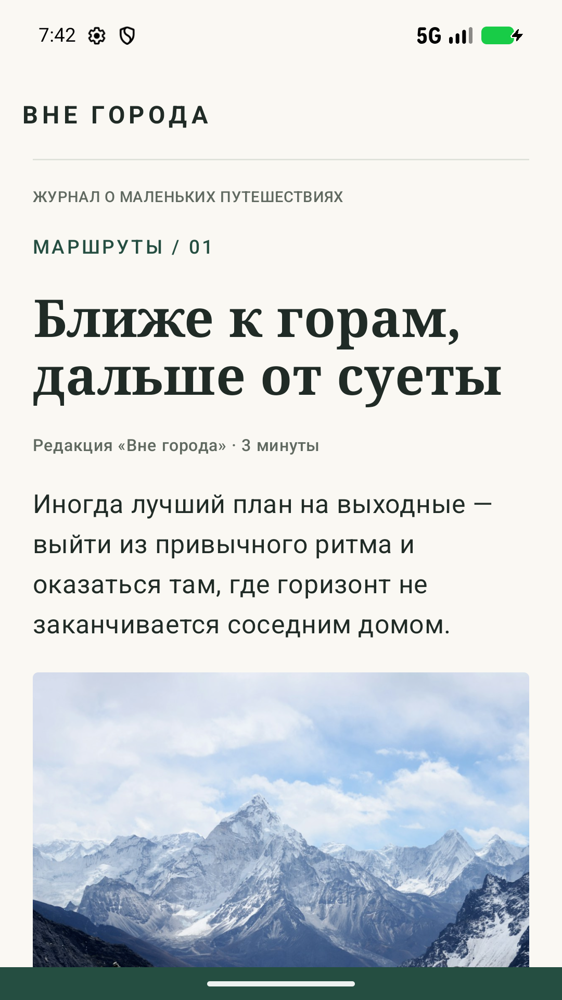
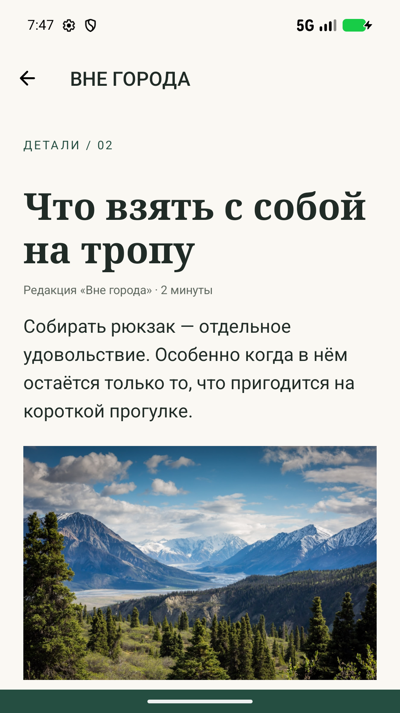
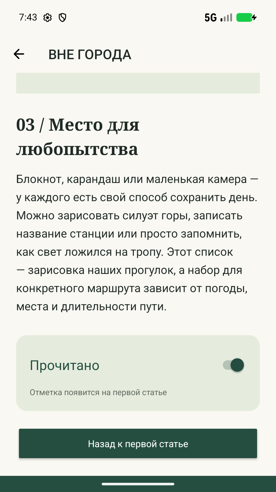
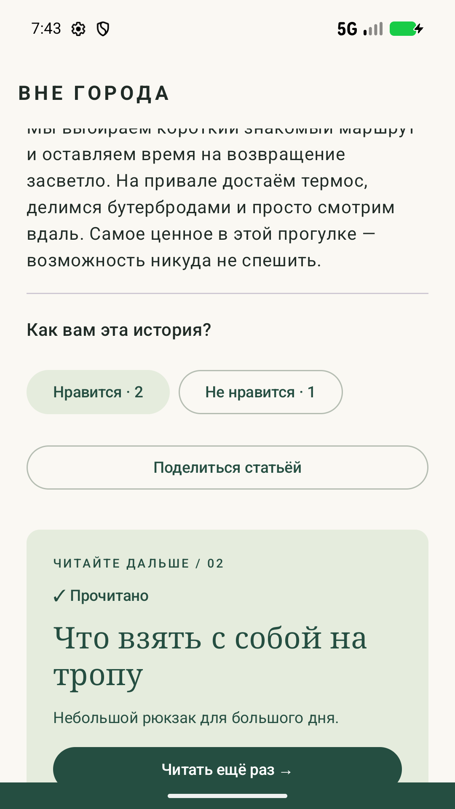

# Практика «Две статьи» — Вне города

Автор: Shubenkin Danil. Ветка: `shubenkin-danil`.

## Реализация

- `MainActivity`: статья «Ближе к горам, дальше от суеты» на Compose. Заголовок с засечками, лид, подзаголовки, основной текст, цитата, фотография и подпись.
- `SecondActivity`: статья «Что взять с собой на тропу» на Views / XML. Другие выравнивания подписи и цитаты, изображение, переключатель и две кнопки возврата.
- Тексты оригинальные и находятся в ресурсах приложения. Из Интернета через Coil 2.7 загружаются только фотографии Unsplash. При загрузке и ошибке сети показана векторная иллюстрация.
- «Поделиться статьёй» открывает системный выбор приложения через `ACTION_SEND`, `text/plain` и `EXTRA_TEXT` с полным текстом первой статьи.
- Кнопки реакций увеличивают независимые счётчики с нуля. Значения сохраняются в `Bundle`, восстанавливаются в `onCreate` и не теряются при переходе на второй экран.
- Первый экран открывает второй явным `Intent` через Activity Result API и передаёт отметку прочтения. Второй возвращает актуальное значение через `setResult`. Работают возврат системной кнопкой / жестом, стрелкой в панели и нижней кнопкой. Можно как поставить, так и снять отметку.
- `Bundle` также сохраняет отметку при пересоздании Activity. Состояние относится к текущей задаче приложения: после удаления задачи и нового запуска счётчики начинаются с нуля.
- `minSdk = 24`: Android 7.0+. Для API 24–25 предусмотрена обычная векторная иконка; для API 26+ — adaptive icon. На иконке изображены горы.
- Финальный манифест фиксирует обе Activity в портретной ориентации. В тесте ориентация первой Activity временно меняется программно, чтобы проверить сохранение счётчиков при настоящем повороте.
- Навигация реализована только через Activity, Intent и `OnBackPressedDispatcher`, без дополнительных архитектурных и навигационных библиотек.

## Запуск и проверка

Открыть корень репозитория в Android Studio. Нужны JDK 17 или 21, Android SDK 34 и устройство / эмулятор с API 24+.

```shell
./gradlew assembleDebug lintDebug
./gradlew connectedDebugAndroidTest
```

В Android Studio в Settings → Build, Execution, Deployment → Build Tools → Gradle выберите Gradle JDK 17 или 21: Java 25 с Gradle 8.7 не поддерживается.

В Windows использовать `gradlew.bat`. На этой машине сборка выполнялась с JDK 21. APK появляется в `app/build/outputs/apk/debug/app-debug.apk`.

Инструментальные тесты проверяют:

1. Два лайка и один дизлайк сохраняются после поворота в альбомную ориентацию, возврата в портретную и `ActivityScenario.recreate()`.
2. Отметка сохраняется после пересоздания второй Activity, возвращается на первую, восстанавливается при повторном открытии и корректно снимается. Проверяются все три способа возврата и сохранение лайка.
3. Меню отправки содержит `ACTION_SEND`, MIME `text/plain` и все разделы первой статьи.

Тестовые зависимости обновлены до Espresso 3.7 / AndroidX Test JUnit 1.3 для работы на новом эмуляторе; версии библиотек самого приложения сохранены из заготовки.

Итог проверки: сборка и Android Lint прошли, 3 инструментальных теста — без ошибок и пропусков. [Результаты тестов](test-results.txt). Среда: Pixel 10 Pro AVD, Android 17 / API 37. Минимальная версия API 24 также проверена в манифесте собранного APK; отдельный запуск на устройстве Android 7 не выполнялся.

## Жизненный цикл

Обе Activity выводят `onCreate`, `onStart`, `onResume`, `onPause`, `onStop`, `onRestart`, `onDestroy` и `onSaveInstanceState`. Для `onCreate` видно наличие сохранённого состояния, для `onDestroy` — признак смены конфигурации.

Фильтр Logcat: `tag:MainActivity | tag:SecondActivity`.

```shell
adb logcat -s MainActivity:D SecondActivity:D
```

Типичная последовательность:

| Действие | События |
| --- | --- |
| Первый запуск | Main: create → start → resume |
| Переход к статье 2 | Main: pause; Second: create → start → resume; Main: stop |
| Возврат | Second: pause; Main: restart → start → resume; Second: stop → destroy |
| Уход на домашний экран | Текущая Activity: pause → stop, сохранение состояния |
| Возврат в приложение | Текущая Activity: restart → start → resume |
| Поворот при временно снятой блокировке | pause → stop → destroy; новый экземпляр: create → start → resume, состояние восстановлено |

Момент `onSaveInstanceState` относительно `onStop` зависит от версии Android. `onDestroy` не гарантируется, если система завершила процесс. В финальной сборке обычный поворот устройства не пересоздаёт экран, поскольку задана портретная ориентация.

## Демонстрация

См. [запись сценария](demo.gif) (1 мин 45 с) и [журнал жизненного цикла](lifecycle.txt). Запись показывает запуск с собственной иконки, чтение обеих статей, реакции 2/1, системное меню отправки, установку отметки, повторное открытие, снятие отметки, портретный экран при запросе поворота и возврат из фона.

Дополнительно: [меню отправки](share-sheet.png), [иконка](launcher.png), [портретная ориентация](portrait-lock.png).


### Экраны

| Compose | Views / XML |
| --- | --- |
|  |  |

| Отметка на втором экране | Результат на первом экране |
| --- | --- |
|  |  |
